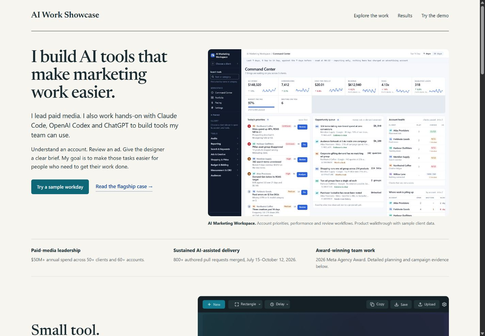
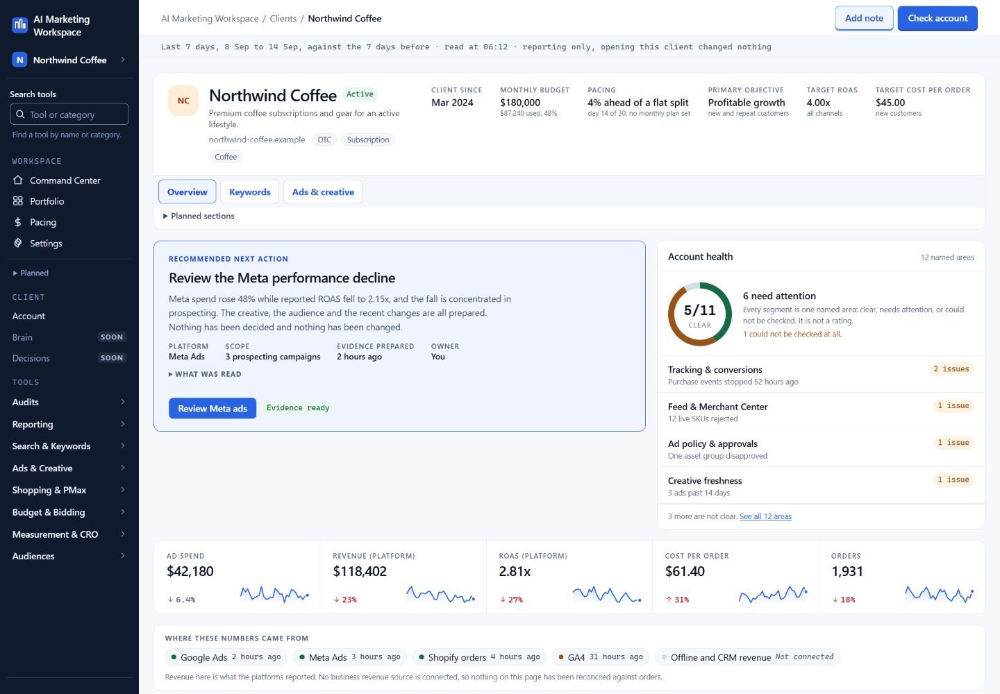

# AI Work Showcase

Practical AI, marketing leadership and hands-on product building. Published as finalpantasy.

[Open the portfolio](https://finalpantasy.github.io/ai-work-showcase/) · [Try the fictional marketing workday](workspace-demo.html).

## Start with the marketing workspace

I build around the work a paid-media strategist actually needs to do: understand an account, explain a change, review ads and prepare the next step. The flagship case includes four product views with sample client data, the decisions behind them and more than 800 merged contributions to the private codebase.

[Read the flagship case](case-studies/marketing-ai-operations.html).

Product design walkthroughs with sample client data. The workspace connects account context, reporting, creative and the team’s next step. Client information and source code stay private.

The interactive public exercise is original demonstration code. Try performance review, creative review and a prepared brief, exact search exclusions, ad-import mapping and knowledge review. It makes no model calls or account changes and stores no work data.

## Explore the work

- [AI Marketing Workspace](case-studies/marketing-ai-operations.html) — Account context, performance investigations, creative briefs, ad review, search terms and a clearer next step.
- [My personal AI brain](case-studies/personal-ai-work-system.html) — Keep useful decisions, evidence and working rules available across projects and conversations.
- [Snipping Tool UL](projects/snipping-tool-ul.html) — A daily screenshot task, a thoughtful editor and measured internal rendering improvements.
- [Compartés holiday campaign](case-studies/compartes.html) — Original budget planning, actual campaign creative, period-specific results and the full submission.
- [Creative strategy and testing](case-studies/creative-work.html) — Customer problems, supported proof, useful briefs and a clear reason for the next ad.
- [Team systems and AI training](case-studies/team-systems.html) — Hiring, onboarding, audits, launch checks and a practical learning path for busy strategists.
- [Ad-launch mapper](projects/ad-launch-mapper.html) — Move planner rows into an import file without retyping approved copy or mixing up assets.
- [Day-ahead planning](projects/daily-planning.html) — Turn near-term tasks into actual drafts, specific decisions and a phone-readable brief.
- [Summoner](projects/summoner.html) — Keep projects, AI conversations, tasks, context and change review together.
- [Claude Quest](projects/workflow-companion.html) — A small local companion for Claude Code, built around work activity without extra model calls.
- [Growth work and results](case-studies/growth-results.html) — Ecommerce, software, events and leadership experience, with the scope behind each figure.

## Campaign evidence

The detailed Compartés holiday case includes original planning, a $200,000 five-stage budget plan, six original creative images, campaign/store results and the full award submission. Outcomes are team results, and the full-season return tradeoff is included.

- [Original planning excerpts](case-studies/compartes-planning.html)
- [Full campaign submission, privacy edited](case-studies/compartes-submission.html)
- [23-page evidence pack](case-studies/compartes-evidence.pdf)

## Useful examples

- [Creative brief](examples/fictional-creative-brief.md)
- [Reviewed knowledge record](examples/fictional-knowledge-record.md)
- [Short AI reporting lesson](examples/ai-reporting-lesson.md)
- [Morning planning brief](examples/fictional-morning-brief.md)
- [Snipping Tool UL internal rendering benchmark](examples/snipping-render-benchmark.md)

Sample client data supports the product walkthroughs and interactive exercises. The Juniper Supply creative is AI-generated. Snipping Tool UL editor previews use a sample image.

## Check the public exercises

Use Node.js: `node --test tests/*.test.mjs`.

The tests cover the financial comparison, field compaction, URL validation, CSV quoting, spreadsheet formula handling and invalidation of an altered preview, along with the earlier exercises. Browser review checks the visible flows and responsive layouts separately.

Private source records, names, account IDs, credentials and client files remain private. A named campaign is included with explicit permission; other client and employer identities are excluded.
