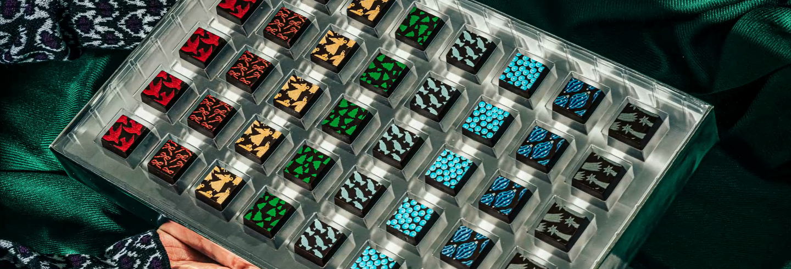
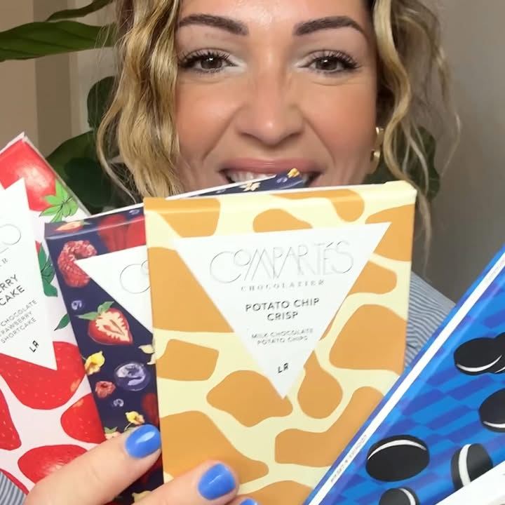
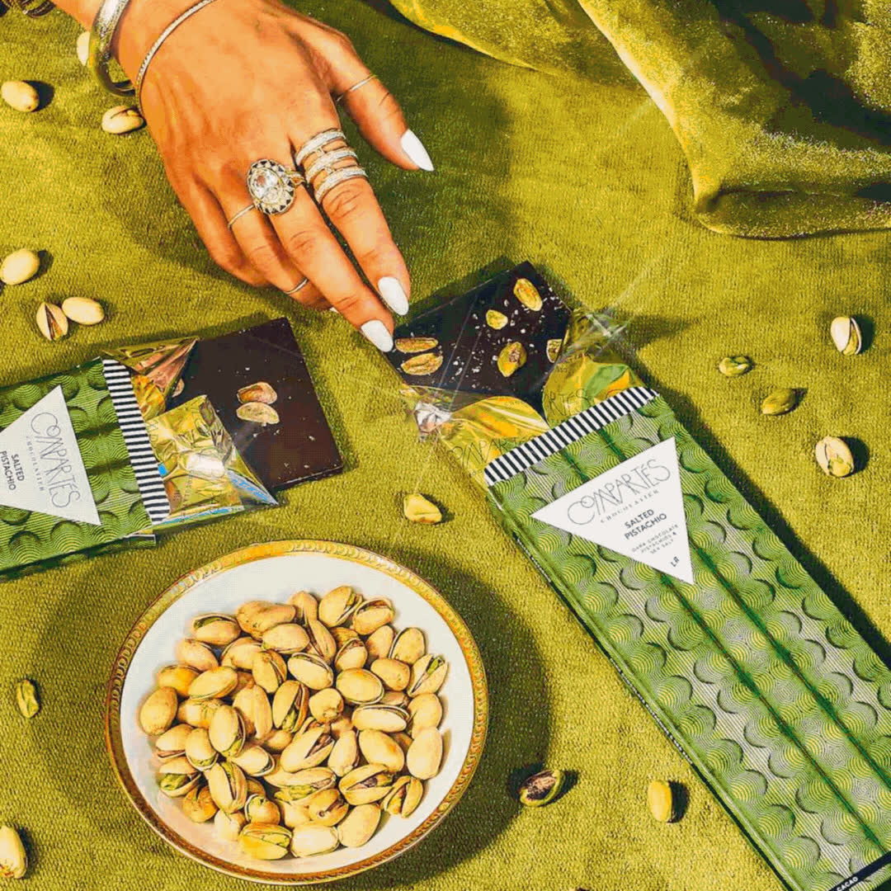
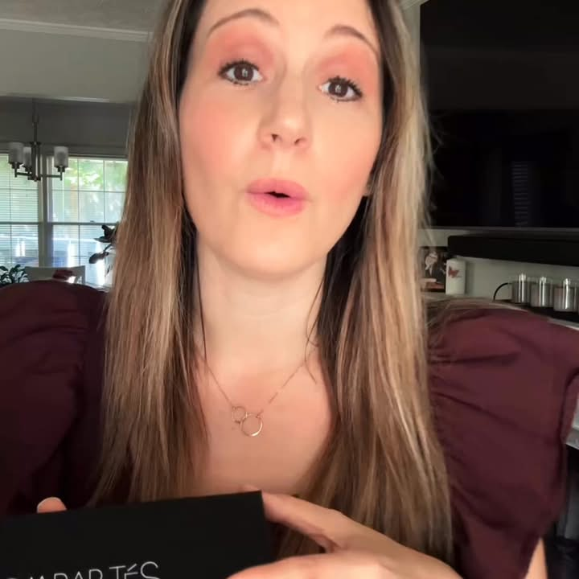
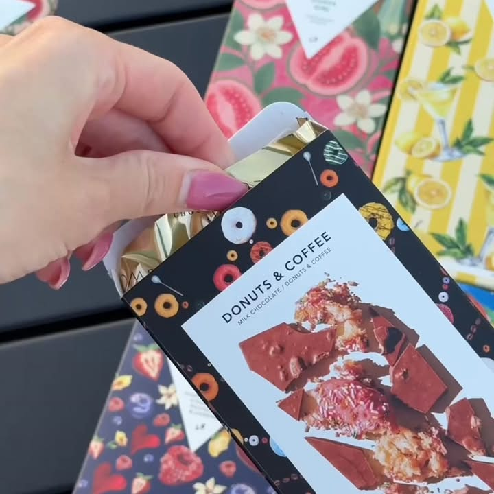
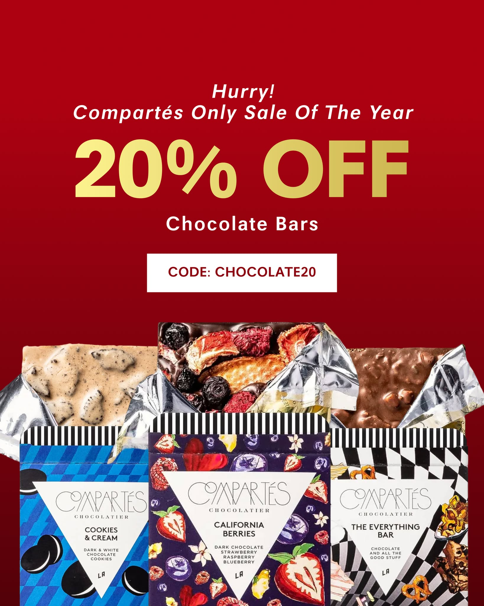

# Compartés: growing holiday sales with a clear plan

2026 Meta Agency Award winner: Performance Campaign of the Year by a Boutique Agency in North America. Campaign: November 1–December 31, 2025. My role: paid-media leadership, budget planning, creative direction, AI-assisted work and the award submission. Campaign results belong to the team.

Compartés needed to sell more chocolate during its busiest season. The job was to reach more gift buyers, give them a reason to buy and spend more when the sales could support it. We finished the season with $2.84 million in Shopify sales. During Black Friday and Cyber Monday, we nearly doubled Meta spend while lowering the cost of a purchase.

This case shows the work behind those results: my original planning tasks, the budget, the ads, the account decisions and the full results. [Read the full campaign submission](compartes-submission.html), [inspect the planning excerpts](compartes-planning.html) or [download the case and evidence as a PDF](compartes-evidence.pdf).

## My work, with original planning evidence

I helped lead paid media and owned the award submission. My original work records also show that I created and was assigned the holiday budget plan and the campaign update task. Those records establish a concrete contribution to planning and direction. They do not mean I personally made every ad or carried out every change.

The update task was created on November 5, 2025 and last updated on November 21, before Black Friday. It calls for larger budgets in measured steps, more compilation videos, holiday creator content, photography and stronger promotion of the advent calendar. One instruction reads:

> Increase budgets 10-20% WoW

Another calls for a daily check of budget, spend, revenue, marketing efficiency and platform return. That is the work of keeping the team focused: decide what to make, what to watch and how quickly to increase investment. The public excerpt removes people's names and internal links; the private original retains the author and assignment fields.

The budget-plan task was created November 7 and last updated December 15. It contains a $200,000 Meta plan with five stages, built around the previous year's demand pattern. Because that task was edited during the season, I describe it as the recorded operating plan rather than claiming every final note was present on November 7.

My AI use supported this work: creative ideas, copy, research, analysis and tools to help with account decisions. I chose the business questions, directed the work, reviewed the output and helped turn it into action. Creators, designers and other strategists contributed the assets and execution. The award recognizes that shared campaign work.

## The business problem

Premium chocolate is a crowded holiday category. Buyers are choosing a gift, comparing prices and trying to get it delivered on time. Compartés has a strong visual advantage: unusual flavors, striking packaging and products that look like a thoughtful gift. The ads had to make those advantages easy to see.

We needed to grow quickly without spending the whole budget too early. We also needed enough useful creative for Meta to find different kinds of buyers. One ad cannot do all of that: a product close-up, a creator explaining a flavor and a clear sale message each give someone a different reason to act.

The operating target was an account-level Meta return above 4x, meaning more than four dollars of attributed purchase value per dollar of ad spend. We checked that alongside store sales and overall advertising cost. Return on ad spend is a revenue measure; it is not profit.

## The $200,000 holiday plan

The plan divided the season by how people were likely to shop. Early November was for lighter testing. The weeks before Black Friday built momentum. The heaviest investment went into the sale and the following peak. December focused on gifting, delivery deadlines and then purchases after the holiday.

| Stage | Dates in the planning task | Planned Meta budget | Purpose |
| --- | --- | --- | --- |
| Early warm-up | November 1–7 | $15,000 | Keep testing light while early demand is weaker |
| Before Black Friday | November 8–21 | $40,000 | Build toward the sale and test creative |
| Sale and extended peak | November 22–December 8 | $85,000 | Put the most investment into the strongest demand period |
| Holiday gifting | December 9–20 | $45,000 | Support gift purchases before delivery cutoffs |
| After the holiday | December 21–31 | $15,000 | Continue where lower competition and self-gifting support sales |
| Total plan | November–December | $200,000 | Five stages with room to adjust daily |

These are planned amounts from the task, not actual spend by stage. Its rough percentage notes do not all match the dollar amounts, so the table uses the dollars, which add to $200,000. The $85,000 peak allocation covers a longer window than the nine-day Black Friday results below.

Final Meta spend was $201,210.57, about 0.6% above the plan. The team used 10–20% budget increases and checked performance before the next increase. This gave the team a shared plan without pretending that a holiday account could run on a fixed schedule alone.

## Four clear jobs for the campaigns

I wanted the account to be easier to understand and act on. The submission describes four commercial roles: keep proven ads selling, support the sale, let shoppers discover products and launch seasonal items. Each role had a clear reason to exist.

| Campaign role | What it did | Reported spend | Meta return |
| --- | --- | --- | --- |
| Evergreen | Keep proven sales ads running | $121,805.49 | 5.29x |
| Black Friday promotion | Give buyers a clear reason to act during the offer | $25,514.00 | 4.42x |
| Shopping and catalog | Show relevant products from the catalog | $22,820.86 | 3.44x |
| Seasonal products | Promote limited editions and the advent calendar | $29,064.53 | 3.17x |

These four selected roles total $199,204.88. They leave $2,005.69 of the account total outside this breakdown. The submission does not explain that remainder. Also, the Black Friday campaign row is one campaign role across the season; the nine-day account result includes other campaigns running at the same time.

The account used Meta's Advantage+ Audience for approximately 87% of consumer spend and kept placements open. In plain English: give Meta room to find buyers, then judge the result. First-party inputs, including Shopify audiences, customer segments, purchaser exclusions and selected lookalikes, provided additional guidance.

We kept a place for specific tests too. A household-income and Online Shopping test returned 7.12x. Broad delivery was the core, while separate tests let the team challenge assumptions and see where another approach could work.

## Actual creative from the campaign

The images below are reproduced unchanged from the original award submission. They show real campaign assets, not newly made portfolio mockups. Video ads and the GIF appear as still images here. Spend, return and click-through rate are the figures reported for each featured ad in the submission.

### Creator video: show the product in someone's hands

Spend: **$13,955.15**. Meta return: **6.15x**. Click-through rate: **0.93%**. This was the submission's highest-spend featured ad. It puts the packaging and product in a person's hands, which makes the size, variety and gift appeal easy to understand. I directed campaign needs; the creator made the video.

### Pistachio creative: keep a proven asset working

Spend: **$11,277.32**. Meta return: **7.12x**. Click-through rate: **0.76%**. The submission says this creative first ran in June 2024 and remained useful during the 2025 holiday refresh. The lesson is practical: add new ideas while keeping an older ad that still sells. This is a still, not a playable GIF.

### Evergreen compilation: give the buyer more ways to connect

Spend: **$10,818.38**. Meta return: **5.38x**. Click-through rate: **1.13%**. Multi-creator videos brought different people and product moments into the same format. The campaign did not depend on one creator or one message.

### Black Friday compilation: connect product interest to the sale

Spend: **$9,466.06**. Meta return: **4.65x**. Click-through rate: **1.82%**. The planning task specifically asks for more compilation videos and holiday creator content. This is an example of that format appearing in the campaign, rather than proof that I personally edited this video.

### Sale static: make the offer impossible to miss

Spend: **$8,220.54**. Meta return: **3.83x**. Click-through rate: **1.48%**. The ad clearly states the discount and code alongside the bars. Its return was lower than several evergreen winners. It still shows the promotional role: make the offer understandable at a glance. A clear ad is not automatically the best-returning ad.

### Catalog ads: let the product set do more work

The featured catalog ad spent **$9,467.88**, returned **3.35x** and had a **2.19%** click-through rate. It has no single fixed creative image because Meta assembled the ad from the product catalog. I have kept it as a written example rather than inventing a screenshot of it.

The wider creative mix included at least seven creators, compilations, statics, GIFs, product stories and catalog treatments. Assets were prepared for square, portrait and vertical placements. The team tested new hooks, copy and formats while keeping winners in place.

Holiday creator Round 2 returned 5.79x versus 5.02x for Round 1. Closing-urgency creative returned 4.76x. A subscription test returned 4.79x and earned more budget. Those are observed campaign results, not controlled tests proving that one creative choice caused the difference.

## Where AI helped me do the work

There were two kinds of AI in this story. Meta's delivery system chose who saw each eligible ad and where it appeared. My own AI use helped with the human work around that system: working through ideas, writing and refining copy, researching, analyzing results and building tools.

My job was to turn those capabilities into something the team could use. A strategist needed a useful brief, a clear next step and a reason for a budget decision. I used AI to help produce and review that work. I still had to judge whether the idea fit the product, whether the claim was supported and whether the next action made commercial sense.

That is also why I build a private marketing workspace and a personal AI brain. The marketing workspace brings account context, performance explanations, creative briefs, ad reviews and budget checks together. The brain keeps useful decisions, evidence and working rules available across projects. The goal is less repeated explanation and preparation for the people doing the work.

Those systems are ongoing projects with their own cases. I am not presenting their current features as if every one existed in November 2025. [See the marketing workspace](marketing-ai-operations.html) and [the personal AI brain](personal-ai-work-system.html) for the separate scope.

The award submission documents the campaign setup and results. My regular use of AI for creative, copy, analysis and tooling is part of my contribution. There was no test separating an AI-only effect, so I do not claim that AI alone produced the sales growth.

## Black Friday: more spend, better purchase economics

This comparison uses the same weekdays around Black Friday and Cyber Monday: **November 24–December 2, 2025**, against **November 25–December 3, 2024**. Both are nine-day account-level windows.

| Meta measure | 2024 | 2025 | Change |
| --- | --- | --- | --- |
| Ad spend | $33,032 | $65,726 | +99.0% |
| Attributed purchase value | $135,422 | $277,208 | +104.7% |
| Attributed purchases | 1,012 | 2,233 | +120.7% |
| Return on ad spend | 4.10x | 4.22x | +2.9% |
| Cost per purchase | $32.64 | $29.43 | −9.8% |
| Cost per 1,000 impressions | $33.31 | $22.67 | −31.9% |
| Click-through rate | 1.395% | 1.508% | +8.1% relative |

This was the strongest scaling result in the submission. Spend nearly doubled, purchase value grew a little faster than spend and the cost of a purchase fell. It was useful evidence that the account could take more budget during the peak without losing purchase efficiency.

## The full season: more volume, with a return tradeoff

The full-season comparison is **November 1–December 31 in each year**. It answers a different question from the nine-day sale window.

| Meta measure | Holiday 2024 | Holiday 2025 | Change |
| --- | --- | --- | --- |
| Ad spend | $125,927 | $201,211 | +59.8% |
| Attributed purchases | 4,646 | 6,924 | +49.0% |
| Attributed purchase value | $636,562 | $926,640 | +45.6% |
| Impressions | 8,311,802 | 11,418,646 | +37.4% |
| Click-through rate | 0.980% | 1.375% | +40.3% relative |
| Cost per click | $1.55 | $1.28 | −17.1% |
| Adds to cart | 34,410 | 78,509 | +128.2% |
| Cost per add to cart | $3.66 | $2.56 | −30.0% |
| Checkouts started | 9,807 | 18,860 | +92.3% |
| Cost per checkout | $12.84 | $10.67 | −16.9% |

Dividing the reported purchase value by spend gives a full-season Meta return of about **5.06x in 2024 and 4.61x in 2025**. Those two values are calculated from the submission, rounded to two decimals. Overall return declined, even though purchases and sales grew. The 2025 account remained above the 4x operating threshold.

The decision was not simply to maximize the return figure. It was to grow the business within agreed spending and efficiency limits. The lower costs earlier in the shopping path were encouraging, but they did not erase the lower full-season return per advertising dollar.

## Store results and new customers

Shopify provides the total-store view. These numbers include the effect of all channels and other influences, rather than only sales attributed to Meta.

| Shopify measure | Holiday 2024 | Holiday 2025 | Change |
| --- | --- | --- | --- |
| Orders | 15,982 | 21,112 | +32.1% |
| Total sales | $2,136,002 | $2,843,922 | +33.1% |
| Average order value | $126.23 | $126.93 | +0.6% |
| First-time customer orders | 8,303 | 11,800 | +42.1% |
| Returning-customer orders | 7,679 | 9,312 | +21.3% |
| First-time share of orders | 51.95% | 55.89% | +3.94 percentage points |

First-time customer orders grew faster than returning-customer orders. Average order value stayed close to $127, so the growth was largely about more orders rather than a large rise in the typical order's value.

Across Meta and Google, combined spend rose 19.2%, compared with 33.1% growth in store sales. Shopify sales per combined advertising dollar increased from 7.40x to 8.26x. Combined spend as a share of Shopify sales fell from 13.52% to 12.10%.

The submission also reports combined ad spend per first-time order falling from $34.77 to $29.17. That calculation uses all first-time store orders. It is a business-level ratio, not a verified channel acquisition cost.

## Cross-channel and placement decisions

The team reviewed Meta and Google together. More of the advertising budget moved toward Meta, while Google reported more conversions on less spend.

| Advertising spend | Holiday 2024 | Holiday 2025 | Change |
| --- | --- | --- | --- |
| Meta | $125,926.72 | $201,210.57 | +59.8% |
| Google Ads | $162,764.26 | $142,957.99 | −12.2% |
| Combined | $288,690.98 | $344,168.56 | +19.2% |

Google reported 28.8% more conversions. That is a separate platform result; it should not be added to Meta purchases as if both systems count sales in the same way.

Open placements also gave the team more ways to reach buyers. Instagram Stories combined meaningful spend with a strong return. Facebook Reels Overlay returned more per dollar, but on a much smaller budget.

| Selected Meta placement | Reported spend | Return |
| --- | --- | --- |
| Facebook Feed | $72,052 | 3.83x |
| Instagram Feed | $56,103 | 4.73x |
| Instagram Stories | $31,605 | 6.23x |
| Instagram Reels | $15,396 | 4.19x |
| Facebook Reels | $12,367 | 2.70x |
| Facebook Reels Overlay | $4,933 | 8.16x |
| Facebook Stories | $2,245 | 4.15x |

A placement's past return is not a promise that it can absorb unlimited spend at that return. The comparison helped the team understand the mix; it did not justify putting the whole account into the smallest high-return placement.

## How I read and explain the results

The submission used Meta's seven-day click and one-day view attribution setting consistently in both years. Meta measured ad delivery and attributed purchases. Shopify measured store sales, orders and customer mix. Triple Whale was used to cross-check reporting. Pixel and server-side purchase signals supported measurement; the submission reports a Purchase Event Match Quality score of 9.3.

There was no Meta Lift study or other holdout study. Agreement across reporting systems supports confidence in the reported pattern, but does not tell us how many sales would have happened without the advertising. Neither store sales per ad dollar nor platform return measures profit.

The broader published holiday case also reports +56% web sales, +81% Meta revenue, 4.26x Meta return, +34% Google return and +58% corporate gift leads. That page does not specify the exact comparison window for those headline figures. They are separate published claims, not replacements for the dated November–December tables here. I would reconcile the period before using them in the same chart.

The public evidence includes the original planning excerpts, original creative images and the campaign section of the submission. Private account exports, internal links and identity fields remain private. The figures on this page are checked against the submission and published case, not a fresh query of the 2025 accounts.

## What I bring to the next team

This work connects strategy to the details that make it happen. I can turn a revenue goal into a budget plan, give creative a clear job, help strategists make account decisions and explain the results without hiding the tradeoffs. I can also use AI to build better tools around that work.

The next improvement would be to plan a lift test, clean up the small campaign-breakdown mismatch and keep the comparison window attached to every published result. Those are practical ways to make the next case easier to defend.

[Read the full campaign submission](compartes-submission.html) · [Read the original planning excerpts](compartes-planning.html) · [Download the PDF evidence pack](compartes-evidence.pdf)
