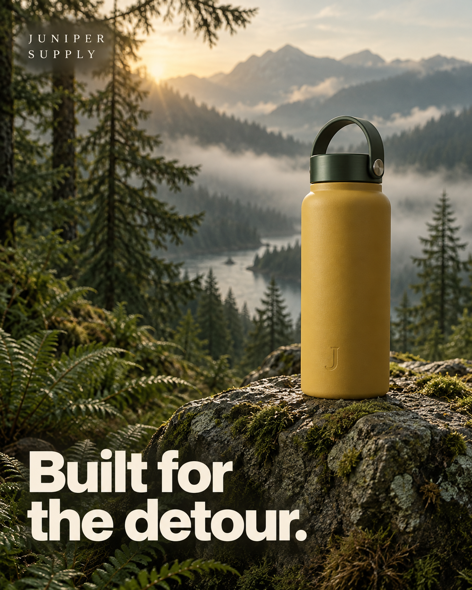

# Give the next ad a clear reason to exist

Existing creative tools and workflow design. Broader creative-process rollout remains planned. Public examples are fictional.

I work on creative strategy from the customer's point of view: what are they trying to do, what is stopping them and what would give them a useful reason to act? AI helps me research, draft, compare and build tools around that work. The brief still needs a clear idea.

One of my main goals is to make the handoff to a designer easier. “Make more ads” is not a good brief. The designer needs to know who the ad is for, what the ad should say, what proof is available and what we want to learn.

## Start with a customer problem

The private brief tool draws on available account context, approved messages, customer language, past creative and performance. It helps bring those inputs together rather than expecting a strategist to find and paste them into an empty chat.

The output is designed around a buying moment, an objection, a promise and the proof that supports it. It also includes the product or offer, format, call to action and destination. Those details give the creative team something specific to build.

If proof is missing, the tool needs to say so. It should not invent a product benefit because the rest of the brief reads well. The system distinguishes a useful draft from a brief that is ready for production.

## Test a real idea, not ten random variations

A test is easier to learn from when we know what changed. The brief identifies a planned variable and what should stay the same. Two concepts can then compare a strategic message without changing the audience, offer, landing page and format at the same time.

This does not mean every platform experiment is perfectly controlled. Delivery and customers can still differ. It means we give the team a useful test question and avoid changing everything before asking why one ad performed differently.

## A fictional brief you can inspect

The public sample is for Juniper Supply, an invented outdoor brand. Its made-up product is a reusable bottle. The example customer is someone packing for a short hike who wants less fuss when getting ready.

| Brief field | Example |
| --- | --- |
| Buying moment | Packing for a weekend walk |
| Customer concern | Choosing useful gear without overcomplicating the trip |
| Message to test | Easy preparation versus the pleasure of a small detour |
| Available proof | Product shape and carry handle are visible in the sample image |
| Claims still needing proof | Leak resistance, temperature retention and durability |
| Keep the same | Product, audience, format, destination and offer |
| Call to action | Explore the bottle |

The image is AI-generated for the fictional brand. It has not run in a real advertising account. The performance figures in the exercise are invented and do not establish which message works.

[Open the full sample brief](../examples/fictional-creative-brief.md) or [try preparing it in the demo](../workspace-demo.html#creative).

## Review the picture and the words together

The creative-review work in the platform combines results with the ad itself. It can prepare notes for different readers: a client needs a clear explanation, while a designer needs a useful next concept.

An observation should stay close to its evidence. If a small group of ads shares an opening question and performs better in a particular window, that may suggest a direction to test. It does not prove the question caused the improvement. The report needs the number of ads, the window and the limits of the comparison.

The product's creative-confidence work also considers whether enough delivery has happened to make a purchase-performance judgment. A new ad should not automatically be called a failure because it has no orders after very little spend. Awareness work needs different judgment from a purchase campaign.

## Make the review useful for the next person

Good notes identify what to keep, what to try and why. For the fictional bottle example, I would keep the product visible and the message short. I would test the buying reason before adding unverified claims about insulation or durability. I would ask for the relevant product evidence before approving those claims.

This is the kind of practical direction I want an AI tool to help prepare. It should save the strategist from assembling the inputs and give the designer a better starting point. It should not create a pile of generic copy that still needs someone to decide what matters.

## Connect the work from brief to learning

I have also worked on a broader creative operating system: preparation, production, quality review, launch and learning. It separates account evidence from task ownership and makes the handoffs explicit.

That broader process is still awaiting some leadership and rollout choices. The existing brief and review tools are a more concrete part of the work. I keep those stages clear so a planned team process is not presented as a completed transformation.

The [ad-launch mapper](../projects/ad-launch-mapper.html) handles another practical handoff. It converts planner content into the fields the launch tool expects and checks the copy, links and assets before import.

## My contribution and what it shows

I define the marketing questions, the brief structure, the evidence needs and the review standard. I work hands-on with AI to build and improve the tools, then check whether the result is useful to the person doing the work.

This demonstrates customer thinking, creative strategy, test planning and AI-assisted product delivery. The campaign results live in the separate campaign case; the invented example here demonstrates my method, not a commercial outcome.
