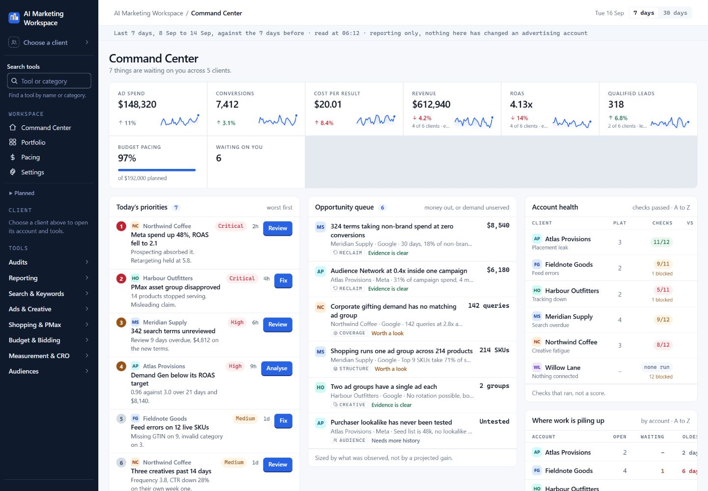
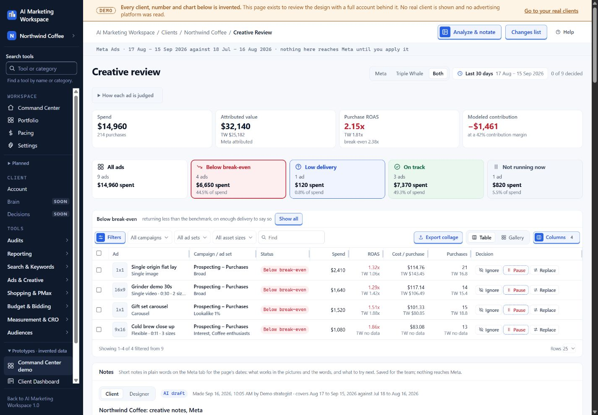
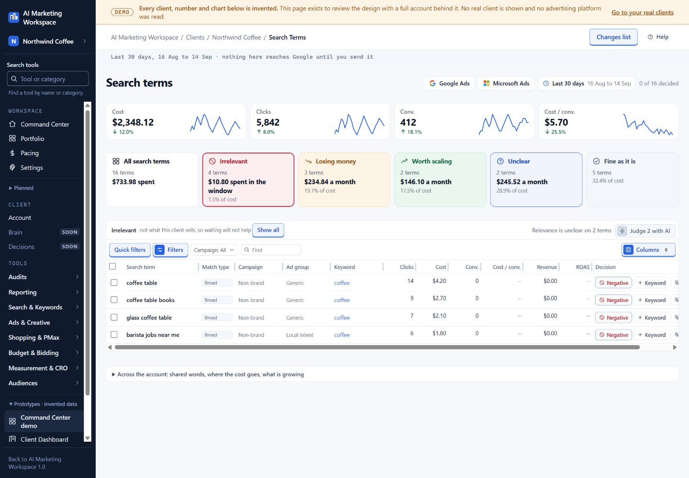

# AI that helps a marketing team get its work done

AI strategy, product direction and hands-on delivery for a paid-media team. Product walkthroughs use sample client data.

I lead paid media, and I have a very practical reason for building this platform: I want the team's work to be easier. A strategist should be able to open an account, understand what matters and prepare the next step without becoming an AI expert.

That means starting with the tasks people already have. Why did results change? Which ad needs attention? What should the designer make next? Are we spending according to the plan? What did the client approve? I work on putting the answers and the work in one place.

[Try a sample workday](../workspace-demo.html). Inspect a performance change, review ads, prepare a brief and stage a search-term decision in a self-contained portfolio exercise.

Product design walkthrough: account priorities, opportunities and health checks, shown with sample clients.

## The problem I am trying to solve

A good paid-media strategist has a lot to keep in their head. There are campaign numbers, customer goals, old decisions, new creative, tracking issues, tasks and client messages. The information is spread across tools. Knowing which tab to open can become a job of its own.

Giving someone an empty AI chat box does not solve that. They still need to know what to ask, which source to use, how to judge the answer and what to do with it. If using AI adds work, a busy teammate will stop using it.

My approach is to build AI into a recognizable task. The person opens creative review because they need to review ads. They ask about a performance change because they need to explain the week. The tool brings in the relevant account information and returns something they can check and use.

The product should do the preparation. The strategist should be able to make the decision.

## My part in the work

I bring the marketing knowledge, choose the problems worth solving and work hands-on with Claude Code, OpenAI Codex and ChatGPT to build the solutions. I turn real work into requirements, work through the proposed behavior, review changes and keep fixing the rough parts.

That includes small details that make a big difference to a teammate. A recommendation needs the right date range. Missing information needs to look missing. A draft needs to remain a draft. A designer needs a reason for the next ad, not ten variations of the same vague instruction.

My role combines paid-media leadership, product direction, AI-assisted delivery and quality review. I judge the result by the task: can a strategist understand the account, make a useful decision and complete the work more easily?

## Start with the account, not an empty prompt

The account view brings together its goals, budget, performance, work and constraints. A person can see what is happening before opening a tool. The product also keeps useful client context, such as the products that matter, the target customer, approved copy constraints and upcoming events.

The demo makes a useful distinction between urgency and preparation. A tracking failure can be urgent even when there is not enough data to diagnose it. An ad review can be ready for a decision even when it is less urgent. Putting both facts on the page helps people choose the right next step.

The account view puts a recommended review beside the business goals, performance and source freshness. That gives the strategist a useful starting point before digging into individual campaigns.

## Explain a performance change in words people understand

One of the tools investigates what changed between two comparable periods. It starts with the numbers, looks for measured contributors and produces a short explanation with supporting evidence. It can use the relevant business reporting source when available, with an explicit fallback when it is not.

The investigation distinguishes measured changes from possible explanations. It combines reporting with notes, task history and recent changes, helping the strategist decide where to investigate next.

A useful output answers four questions: what changed, where the change is concentrated, what the available evidence supports and what needs checking next. The original evidence stays with a saved investigation so a later update does not quietly rewrite the earlier explanation.

In the public sample, two seven-day periods show Meta return falling from 3.2 to 2.4 dollars per advertising dollar. Prospecting accounts for the revenue decline while retargeting holds steady. The sample data lets a visitor follow the same investigation process and see how a broad decline becomes a specific question about prospecting.

## Give creative review a clear next step

Creative review combines ad performance, the actual message and a place for the strategist's decision. The product can present ads in a table or gallery, switch the attribution view and prepare notes for a client or designer.

That matters because an ad is more than a row with a return number. We need to understand the picture, the opening line, the customer concern, the offer and whether the ad has had enough delivery to judge. Different attribution sources can also disagree. Hiding that disagreement makes a tidy page and a worse decision.

The review view connects performance, attribution and the strategist’s decision. The public creative exercise adds an AI-generated advertisement and a completed brief for a sample outdoor brand.

I have worked on the next part of the task too: preparing a useful creative brief. The brief brings together the audience, buying moment, objection, promise, available proof, format, call to action and landing page. It identifies the one part being tested and the parts that should stay the same.

The brief includes a readiness check covering the message, product evidence, assets and destination. That gives the strategist and designer a shared review standard. See the fuller [creative strategy case](creative-work.html) and [sample brief](../examples/fictional-creative-brief.md).

## Make search-term review manageable

Search-term work can mean hundreds of rows and repeated decisions. The review view groups the work into useful queues, gives the strategist the account context and keeps decisions visible before anything is applied.

An obviously unrelated search is different from a relevant search with little data. For a coffee business, a search for a coffee table is the wrong product. A search for a coffee subscription with no orders after a handful of clicks needs a more careful reading. Treating both as the same kind of failure wastes judgment.

The public exercise lets a visitor stage search decisions and inspect their exact scope. The platform’s account-action workflow brings the same discipline to preview, approval and verification.

## Keep planning, reporting and account changes connected

The broader platform brings together reporting and account tools with the surrounding work: documents, creative, task history and client context. I have worked on budget and pacing checks, reporting, audits, creative workflows and account actions.

The value is that one task can lead naturally to the next. An investigation should lead to a review. A review should lead to a clear brief or proposed change. A proposed change should show the exact scope before approval. A completed change should be checked and then explained to the team or client.

That does not mean every decision should be automated. It means the tool should remove the searching, retyping and repeated preparation around the decision. The separate [ad-launch mapper](../projects/ad-launch-mapper.html) is another example: it moves approved planner content into the format a launch tool expects.

## Sustained delivery and reliability

The private repository contains substantial ongoing delivery. A scoped review on October 12, 2026 found more than 800 of my authored pull requests merged between July 15 and October 12, 2026. The exact reviewed count was 860.

That sustained delivery covers new features, reliability improvements and maintenance. I stay involved after the first build, working through the details that make the tools dependable for everyday use.

Representative reviewed work includes a reporting feature, a fix to avoid incorrectly flagging copy, and a repair for an advertising-platform field that had changed. That is part of making the tool dependable: correct numbers, accurate checks and clearer behavior when an outside system changes.

I can walk through the product decisions, feature development and review process in an interview. The portfolio makes that work visible through product views and hands-on examples while protecting client information.

## What this work delivers

Across my broader workflow automation, reporting and AI-assisted analysis work, weekly time savings exceed 20 hours. The marketing workspace brings that practical approach into the strategist’s daily tasks.

I bring account context, reporting, creative preparation and review into one workflow. The next-generation product design follows the same adoption principle: begin with a task the team recognizes and make its next step easier.

The work shows that I can identify a business problem, translate it into a usable task, direct AI-assisted development and stay involved through review and repair. It also shows how I think about AI adoption: make the work simpler, make the answer understandable and give people a reason to come back.

[Try the sample workday](../workspace-demo.html), explore [my personal AI brain](personal-ai-work-system.html), or read the separate [marketing results](growth-results.html).
