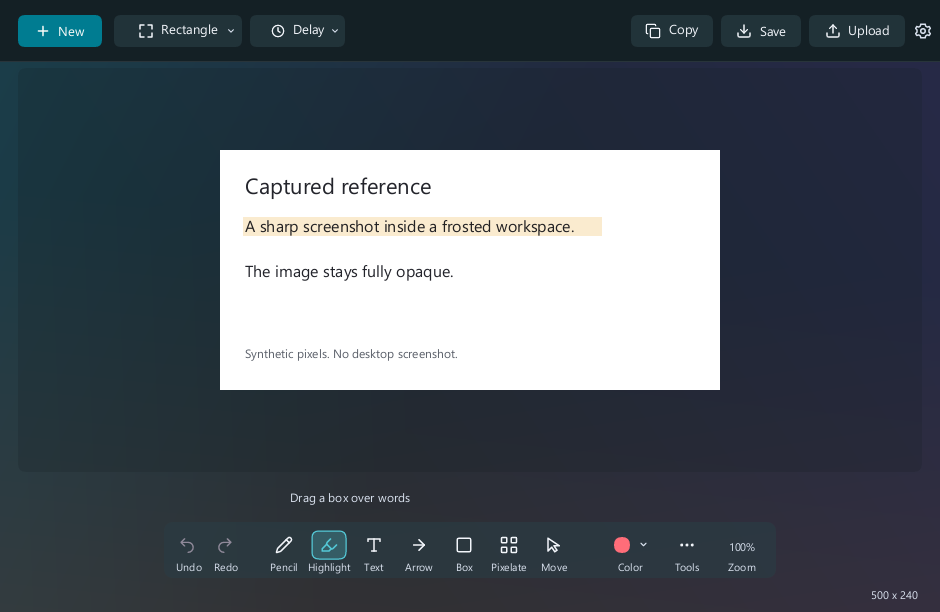
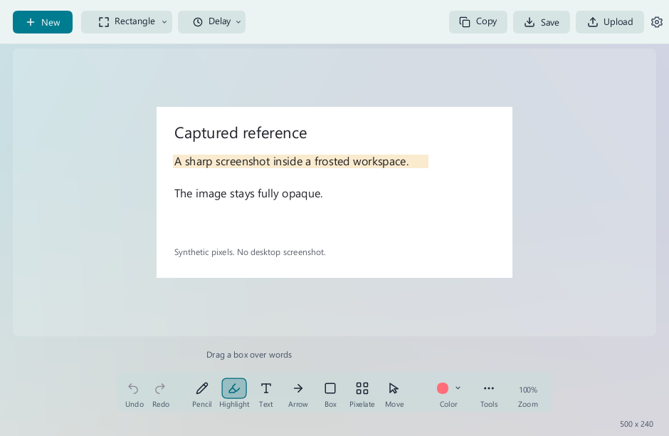

# Snipping Tool UL: a small tool for a daily task

Native Windows 11 app in active development. Installed local preview. Public release and a measured Microsoft comparison are being coordinated with the project owner.

I wanted a screenshot tool that feels light and gets out of the way. The task is common: select an area, paste it into a chat, add a mark when needed and get back to work. Waiting on a heavy interface makes that small task feel bigger than it should.

Snipping Tool UL is a native Rust app built from the MIT-licensed [HydroShot foundation](https://github.com/Real-Fruit-Snacks/HydroShot), with extensive work on the workflow, editor and Windows integration. I do not claim to have invented the upstream capture library.

## Keep the useful features

The app includes region, window and full-screen capture, configurable hotkeys and three-, five- and ten-second delays. After capture, the intended workflow copies the image and opens a preview for editing.

The editor includes pencil strokes, arrows, shapes, highlights, pixelation, text and numbered steps. Width and size controls are visible. Selecting a mark lets you move or change it; deleting a numbered step renumbers the later steps, and undo restores the change.

There is also saving, OCR, optional history and sharing. History and auto-save are off by default. Public uploads happen only when the person chooses them; live upload acceptance remains part of the project's unfinished checks.

## Make lightness a design choice

The app uses no webview or permanent rendering loop. Its event loop can sleep when no work needs drawing. Icon assets are prepared ahead of time rather than parsed on every interaction.

The editor keeps the original image for export while drawing the visible preview at the window's size. That avoids repeatedly doing full-resolution work just to show a smaller view. Copy and save use the original resolution separately.

This is where product and performance meet. A fast preview should still produce a sharp export. Making the preview cheaper should not quietly lower the quality of the file a person saves or pastes.

## The interface

These are actual application client renders produced headlessly with a synthetic image. They are not photographs of a running native window and do not show Windows' title bar or prove capture and paste. Genuine working screenshots are being coordinated for the public release.

The interface uses restrained teal controls, light and dark themes, a frosted workspace and clear tool names. The image stays sharp and opaque inside the surrounding workspace. The supplied bird-and-scissors identity gives the small app a recognizable visual character.

## Measured internal rendering improvements

The retained October 12 version 0.3.5 benchmark compared two rendering paths inside the app, using a synthetic 3840 × 2160 image and a 1410 × 918 editor viewport at 150% DPI.

| Internal rendering path | Warm CPU render time, median of 21 frames | Retained image and render buffers |
| --- | --- | --- |
| Full-image path | 11.484 ms | 71,532,720 bytes |
| Cached viewport path | 4.514 ms | 44,929,008 bytes |
| Difference | 60.7% less CPU render time | 37.2% fewer retained buffer bytes |

Those figures describe a specific internal optimization. Buffer bytes are not the application's total memory. CPU render time is not total process CPU use, startup time or capture-to-clipboard latency. The benchmark excludes desktop capture, native presentation, clipboard and upload.

[Read the benchmark method and data](../examples/snipping-render-benchmark.md).

## The Microsoft comparison

I want a fair comparison with the default Windows Snipping Tool. The current evidence does not include a matched Microsoft baseline or full-app responsiveness test. I therefore do not publish a percentage saving or claim that this benchmark proves UL is faster than Microsoft's app.

The remaining comparison needs the same machine, image dimensions, app state and test sequence, with both memory measures and a clear timing boundary. The current version has 178 passing headless tests and five mocked installer checks. Those checks do not substitute for real capture and paste. The project is preserving the working desktop and keeping native tests isolated. The portfolio will use those results when that comparison exists.

## My contribution

I define the workflow and the visual direction, work with AI on the build and insist that performance and usability stay connected. That includes clear controls, live annotation editing, clipboard ordering, accurate exports, installation behavior and privacy checks.

The app demonstrates a practical kind of AI-assisted building: start with a daily frustration, use an appropriate foundation, preserve its license, make the experience better and check the result. Its small executable and lack of a browser runtime are concrete design choices; broader speed and memory claims still need their own evidence.

Repository publication is in progress. This page will link the public release once it is available, rather than send a reviewer to an inaccessible repository.
