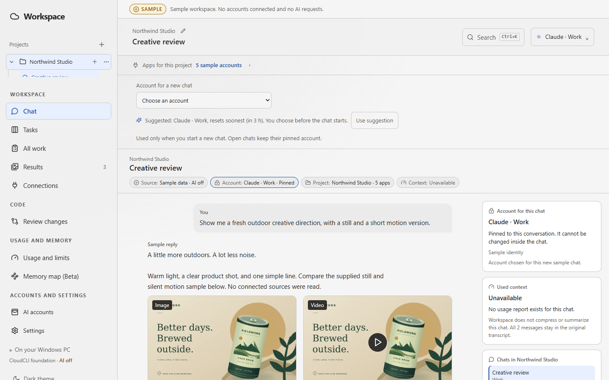
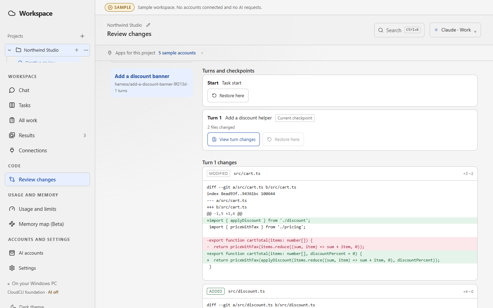

# Summoner: one desk for several AI agents

Summoner is a desktop AI harness I am building for directing several AI coding agents on one project. I choose which AI does each job, it starts with the context it needs, and nothing it produces is final until I approve it. It is an early prototype that runs on sample data.

## Why I am building it

I build AdNexus and my side projects with several AI agents at once: Claude for one task, Codex for another, a second model to check the first. Keeping track of who changed what, which chat holds which decision, and where a project stopped gets messy fast. Summoner keeps the project, not the chat, as the thing that persists.

## What it does

- **I choose the AI.** I pick the agent and account for each job. Summoner can suggest one, and I confirm.
- **It arrives ready.** An agent starts inside the project with its tools, the project context and its memory, so I do not explain the work again.
- **Several at once.** More than one agent can work in parallel without getting in each other's way.
- **Second opinions.** A different model reviews another agent's work before I accept it.
- **Nothing final without approval.** Merges, account changes and other consequential actions wait for me.

Every change an agent makes can be inspected or rolled back before I keep it, the same rule I hold AdNexus to.

## Where it stands

The screens, the review flow and the account choices work on a built-in sample workspace. Live model connections are the next step, and there are no releases yet. I set the product direction and build it with AI assistance on an open-source foundation, keeping its license.

[How AdNexus works](../case-studies/marketing-ai-operations.html) · [My personal AI brain](../case-studies/personal-ai-work-system.html)
